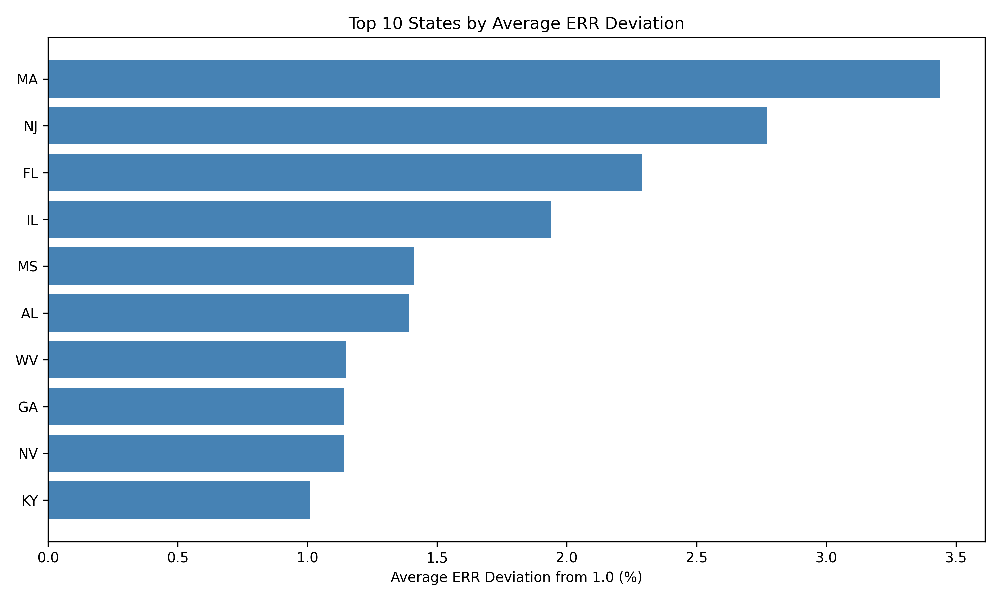
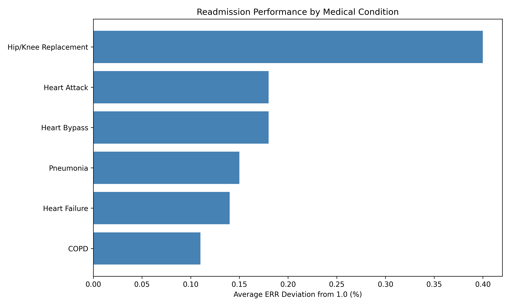
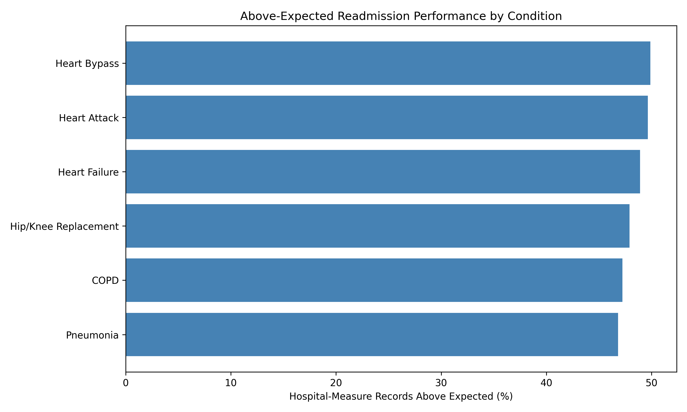
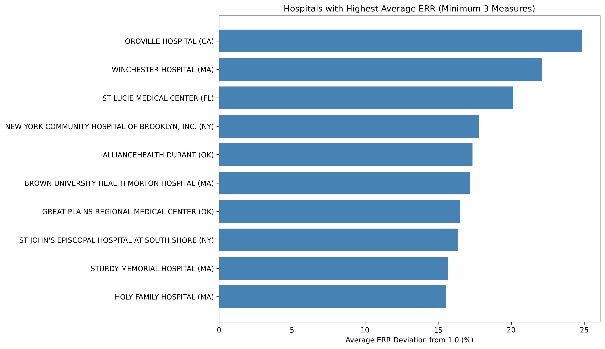
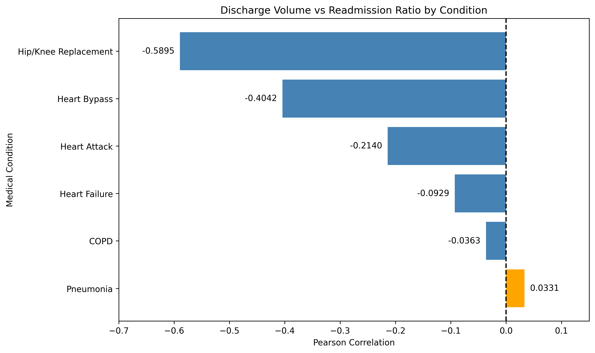

# Hospital Readmission Analysis Using Python

**Exploring hospital performance and readmission patterns using real-world healthcare data**

## About This Project

Hospital readmissions are an important part of understanding healthcare quality and hospital performance. When patients return to the hospital shortly after being discharged, it can raise questions about follow-up care, patient needs, and the effectiveness of treatment.

For this project, I wanted to explore how hospital readmission performance varies across the United States and whether factors such as medical conditions and patient discharge volume are associated with different outcomes.

I used the FY 2026 Hospital Readmissions Reduction Program dataset from the Centers for Medicare & Medicaid Services (CMS). Using Python, I cleaned the data, explored patterns, compared hospital performance, and created visualizations to communicate my findings.

My goal was not just to calculate numbers, but to understand what those numbers mean and how they could help healthcare organizations identify areas worth investigating.

## Tools I Used

- **Python:** For the overall analysis
- **Pandas:** For cleaning, filtering, and grouping data
- **NumPy:** For numerical operations
- **Matplotlib:** For creating charts
- **Google Colab:** For writing and running Python code
- **GitHub:** For sharing my work

## Understanding the Dataset

The dataset contains information about hospitals across the United States and their performance on six 30-day readmission measures.

| Dataset Detail | Value |
|---|---:|
| Total Records | 18,330 |
| Records with Valid Readmission Ratios | 11,720 |
| Records Without Valid Readmission Ratios | 6,610 |
| Medical Conditions/Procedures | 6 |
| Average Excess Readmission Ratio | 1.0018 |

The six conditions and procedures I analyzed were heart attack, heart bypass surgery, COPD, heart failure, hip/knee replacement, and pneumonia.

One important metric in this project is the **Excess Readmission Ratio (ERR)**.

- An ERR greater than 1.0 means readmissions are higher than the risk-adjusted expected benchmark.
- An ERR below 1.0 means readmissions are lower than expected.
- An ERR of 1.0 means performance matches the expected benchmark.

ERR is not the actual percentage of patients who were readmitted.

## How I Worked With the Data

I started by exploring the dataset to understand its structure, column names, data types, and missing values.

I found that 6,610 records did not have valid Excess Readmission Ratios. Instead of replacing those missing values with zero, I excluded them from calculations that required ERR. This helped avoid misleading results.

I also checked for duplicate rows, converted readmission counts into numeric values, formatted the date columns, and created a separate working copy so the original data remained unchanged.

After cleaning the data, I focused on a few questions:

- Which states have higher average readmission ratios?
- How does readmission performance differ across medical conditions?
- Which hospitals have elevated ERR values across several measures?
- Does the number of patient discharges have any relationship with readmission performance?

## What I Found

### 1. Readmission Performance Across States

I first compared the average Excess Readmission Ratio across states.

Massachusetts had the highest average ERR in my analysis at **1.0344**, followed by New Jersey at **1.0277** and Florida at **1.0229**.

This showed me that readmission performance varies geographically. However, these averages combine different hospitals and medical conditions, so I treated them as an initial exploration rather than a definitive ranking of healthcare quality.

### 2. Comparing Medical Conditions

Next, I wanted to understand whether certain medical conditions showed higher average ERR values than others.

Hip/knee replacement had the highest average ERR at **1.0040**, while COPD had the lowest at **1.0011**.

The differences were relatively small, but this analysis helped me understand why it is useful to examine individual medical conditions instead of relying only on an overall average.

### 3. How Often Were Readmission Ratios Above Expected?

I also calculated the percentage of hospital-measure records with an ERR greater than 1.0.

Heart bypass surgery had the highest percentage at **49.89%**, followed by heart attack at **49.65%**. Pneumonia had the lowest percentage at **46.81%**.

One interesting observation was that hip/knee replacement had the highest average ERR, but heart bypass had the highest percentage of records above the expected benchmark.

This showed me that looking at more than one metric can reveal patterns that an average alone might miss.

### 4. Looking at Individual Hospitals

I then explored hospital-level performance.

To make the comparison more meaningful, I focused on hospitals with at least three valid readmission measures. There were **2,392 hospitals** that met this requirement.

Among these hospitals, Oroville Hospital in California had the highest average ERR in the analysis at **1.2484**, followed by Winchester Hospital in Massachusetts at **1.2212**.

These findings helped identify hospitals that could be investigated further. However, I would not use these averages alone to judge the overall quality of a hospital, since hospitals may have different patient populations and available measures.

### 5. Does Hospital Discharge Volume Matter?

Another question I wanted to explore was whether hospitals with more patient discharges tend to have different readmission outcomes.

I created a scatter plot and calculated the correlation between discharge volume and ERR.

The overall correlation was **-0.1296**, indicating a weak negative relationship.

When I divided the records into four discharge-volume groups, I found that the low-volume group had an average ERR of **1.0273**, compared with **0.9937** for the high-volume group.

This suggested a possible relationship worth exploring, but it did not establish that higher discharge volume directly improves hospital outcomes.

### 6. The Relationship Was Different for Each Condition

To explore this further, I calculated the discharge-volume correlation separately for each medical condition.

| Medical Condition | Correlation |
|---|---:|
| Hip/Knee Replacement | -0.5895 |
| Heart Bypass | -0.4042 |
| Heart Attack | -0.2140 |
| Heart Failure | -0.0929 |
| COPD | -0.0363 |
| Pneumonia | +0.0331 |

This was one of the most interesting findings in my project.

Hip/knee replacement showed a moderately strong negative correlation, while pneumonia showed almost no linear relationship.

It helped me understand that a relationship observed across the entire dataset may not apply equally to every medical condition.

## What I Learned From This Project

This project gave me practical experience working with healthcare data, especially handling missing values and understanding how different metrics should be interpreted.

I also learned that data analysis is not only about finding the highest or lowest numbers. It is important to understand what a metric represents, compare results fairly, and recognize the limitations of the data.

For example, a higher Excess Readmission Ratio does not automatically mean that a hospital provides poor care. Other factors, such as patient characteristics, medical conditions, and differences in reporting, need to be considered.

## How These Insights Could Be Useful

Based on this analysis, healthcare teams could use similar methods to:

- Monitor readmission performance across different medical conditions.
- Identify hospitals or measures that may need closer review.
- Explore discharge-volume patterns before making operational decisions.
- Track performance against expected benchmarks.
- Support discussions about where additional quality-improvement analysis may be helpful.

These are potential applications of the analysis, not confirmed causes of readmissions or proven interventions.

## Project Files

- [Python Analysis Notebook](Hospital_Readmission_Analysis.ipynb)
- [State Readmission Analysis](state_readmission_analysis.png)
- [Medical Condition Analysis](condition_readmission_analysis.png)
- [Above-Expected Readmissions](above_expected_readmissions.png)
- [Hospital Performance Analysis](hospital_readmission_analysis.png)
- [Discharge Volume Correlation](discharge_volume_correlation.png)

## Skills Demonstrated

Python, Pandas, NumPy, Matplotlib, Data Cleaning, Exploratory Data Analysis, Data Visualization, Healthcare Analytics, KPI Analysis, Grouping and Aggregation, Correlation Analysis, and Data Interpretation.

## A Note About the Results

This project is an exploratory analysis of the FY 2026 CMS HRRP dataset. The comparisons use hospital-measure records rather than individual patient-level data. The state and hospital averages are unweighted, and the results should not be treated as official hospital quality rankings.

The correlations show associations, not cause-and-effect relationships.

## Final Thoughts

Working on this project helped me connect my technical skills with a real healthcare analytics problem.

I started with a dataset of 18,330 records, cleaned and prepared it using Python, and explored readmission performance from different perspectives. By the end, I had a better understanding of how to approach healthcare data, communicate meaningful findings, and avoid drawing conclusions that the data cannot fully support.

This project strengthened my confidence in using Python for data analysis and showed me how data can help healthcare organizations ask better questions and make more informed decisions.

---

**Sneha Reddy Konatham**

*Data Analyst | Business Analyst | MS in Business Analytics & Project Management*

**Data Source:** Centers for Medicare & Medicaid Services (CMS) — FY 2026 Hospital Readmissions Reduction Program
